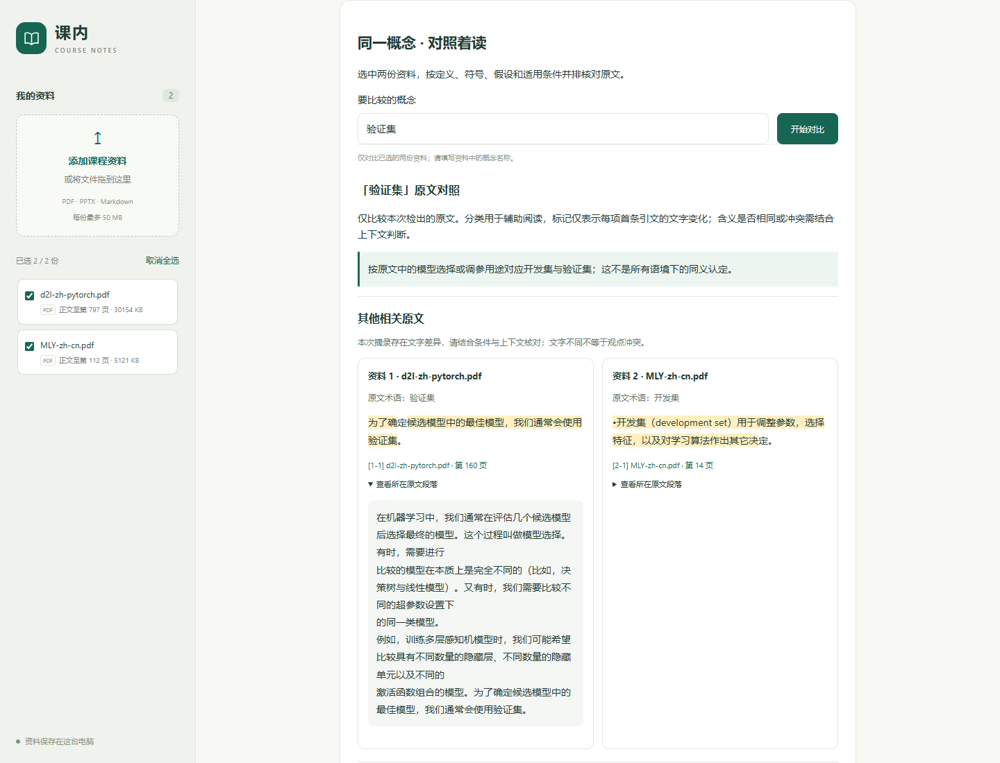
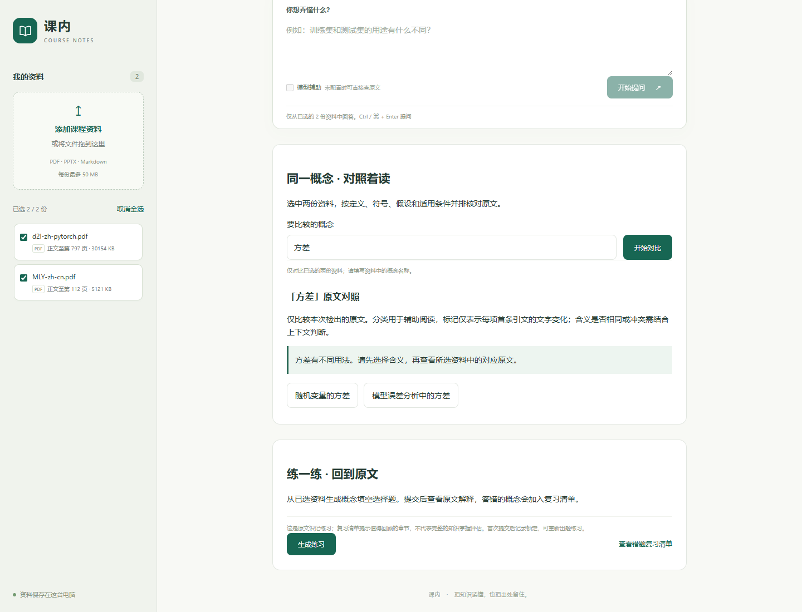

# 术语对齐与方差含义选择（2026-10-26）

跨教材对比现在支持“开发集／验证集”的限定用途对照，并要求“方差”先选含义。证据不足时展示候选出处，不生成已对齐的差异高亮。此版本仅支持这些明确列出的术语与语境，不是通用语义匹配器。

## 使用方式

重启本地网页服务并刷新页面，选中两份教材：

1. 输入“开发集”或“验证集”。系统分别寻找两边关于模型选择或调参的明确原句，显示原文术语、限定用途和页码链接。
2. 输入“方差”。先选择“随机变量的方差”或“模型误差分析中的方差”，再查看对应原文；可以在结果中切换含义。
3. 如果某一边没有明确语境依据，会显示单边未检出。用途无法确认时，即使两边都有候选摘录，也不会高亮跨资料文字差异。

也可直接输入“随机变量的方差”或“模型误差分析中的方差”。修改概念或切换资料后，旧对比会隐藏；有摘录的分类优先显示。

## 实际教材结果

| 输入与选择 | D2L | MLY | 结果 |
| --- | --- | --- | --- |
| 开发集 / 验证集 | 第 160 页“验证集”用于选择候选模型 | 第 14 页“开发集”用于调参等算法决策 | 按模型选择与调参用途对应，保留各自称谓 |
| 方差，未选择含义 | 等待选择 | 等待选择 | 不展示跨资料对比，避免混用语境 |
| 方差，随机变量含义 | 第 98 页，标准差关系的原句 | 未检出支持此含义的摘录 | 单边结果 |
| 方差，模型误差分析含义 | 未检出支持此含义的摘录 | 第 41 页，训练与测试表现差距的操作性说明 | 单边结果 |

页码是从 1 开始的 PDF 物理页。未检出不表示原书不存在对应内容。MLY 中的操作性用法也不代表所有偏差—方差分析都采用这个定义。





## 对齐条件与边界

- 开发集与验证集只在两个所选来源都检出明确模型选择或调参用途时对应；每条摘录保留原文、章节、页码和 `matched_term`。规则不把测试集、交叉验证集或其他相邻名称自动并入。
- 否定、明确错误表述、名称带限定后缀和仅共同出现的词语不构成用途证据。规则属于有限文本模式，不能识别任意复杂否定、引述关系或相互矛盾的论述。
- 方差按摘录内部的明确线索筛选，不因为整章同时提及训练集或随机变量就把全部句子归为一种含义。未知含义、只有数字和同时出现两类线索的句子不会被强行分类。
- 对齐只为阅读提供限定范围，不证明两段话等价。原文差异高亮仍只比较字符；独立语义审核仍待完成。
- 当前规则仅用于跨教材对比，没有将词表扩展到问答、练习或先修关系图。待审核的复习笔记继续单独保存。

## API

`POST /api/compare` 保留原有 `concept` 和两个 `document_ids` 字段，增加可选的 `sense`：

```json
{
  "concept": "方差",
  "document_ids": ["文档一 ID", "文档二 ID"],
  "sense": "random_variable_variance"
}
```

另一含义为 `model_error_variance`。不适用的含义参数、未知值或与完整概念名称冲突的选择返回 400。所选文档及请求令牌仍须通过原有校验。

| 返回状态 | 含义 |
| --- | --- |
| `needs_disambiguation` | 等待选择含义；文档状态为 `pending`，`rows` 为空，不是“未找到内容” |
| `needs_review` | 两边有候选摘录，但缺少限定用途对应的双边依据 |
| `ready` / `partial` / `not_found` | 在当前范围内，两边 / 单边 / 均未检出；`ready` 不代表语义等价 |

`alignment` 返回限定说明及决定：`role_correspondence`、`insufficient_evidence`、`sense_selected`、`needs_disambiguation` 或默认的 `literal_name`。含义选项随响应返回。证据不足时不生成 `parts` 高亮。

## 验证

- 全套自动化测试 **302 项通过**。新增测试覆盖双向术语查询、否定和限定词、来源范围、混合语境、含义切换与参数错误、证据不足不高亮，以及评测不能只凭“有出处”判通过。
- [固定真实教材检查](../eval/course-alignment-v1.json) **11 / 11**，两次重新提取和运行结果一致；返回摘录均逐字对应来源，差异标记没有改写原文。
- 原有 7 组字面对照检查仍通过；它们保留旧的检出范围，不代表新版网页的术语对齐决策。[回归报告](../eval/reports/course-pairs-after-alignment.json)。
- Chrome 检查了真实教材的双向术语输入、两种方差含义切换、直接输入完整概念名、输入与选材变化清除旧结果。另用临时笔记验证证据不足提示及无高亮。390px 手机布局无横向溢出，无脚本异常；默认资料库未被测试修改。
- Ruff、JavaScript 语法检查及差异空白检查通过。

[完整教材评测报告](../eval/reports/course-alignment-v1.json)、[网页验证记录](../eval/reports/course-alignment-browser-v1.json)。开发案例由助手检查材料后整理，未经过独立人工审核，不是留出测试集，也不代表任意教材上的语义正确率。

复现命令：

```powershell
.\.venv\Scripts\python.exe -X utf8 -m scripts.evaluate_course_pairs --manifest eval/course-alignment-v1.json --output eval/reports/course-alignment-v1.json
.\.venv\Scripts\python.exe -m pytest -q --basetemp .tmp/alignment-tests
```

来源仍锁定为之前两份 PDF 的 SHA-256；未修改教材、向量索引或草稿笔记。后续工作是扩展经核对的术语与语境案例，并由课程负责人审核语义对应和复习顺序。
