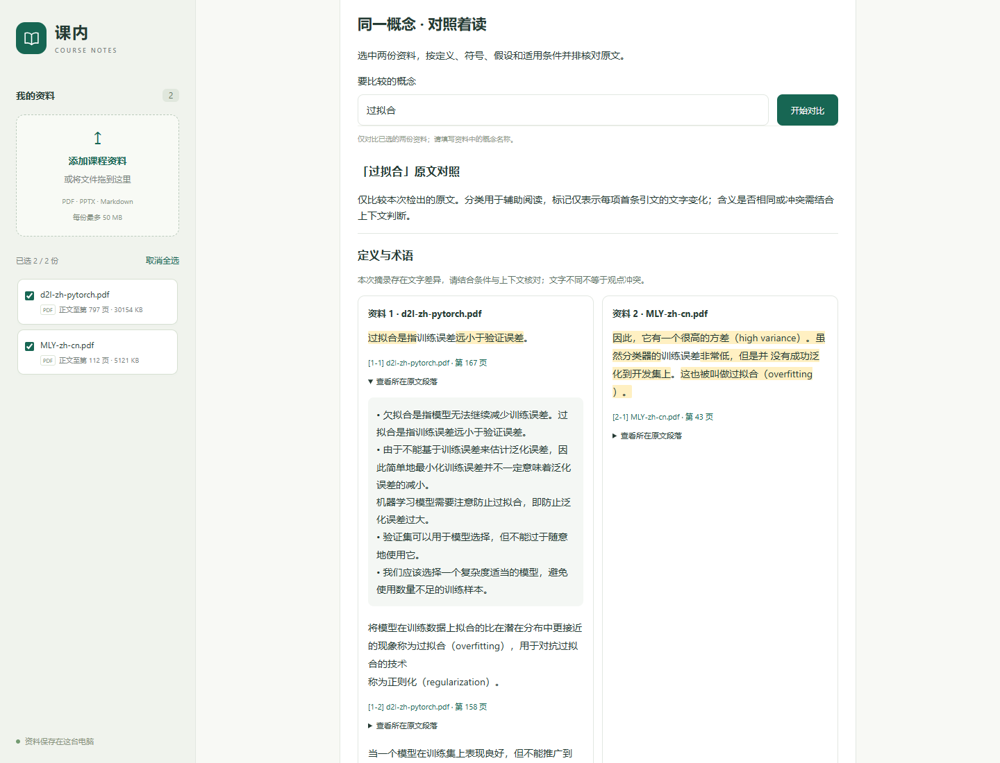

# 双教材原文对照验证（2026-10-26）

后续进展：正则化列表条目漏检已修复，新增复习笔记草稿，见[第二轮记录](course-pairs-v2.md)。下文保留本轮历史结果。

已将用户提供的《机器学习训练秘籍》`MLY-zh-cn.pdf` 与现有 `d2l-zh-pytorch.pdf` 导入本地网页资料库，完成真实 PDF 的提取、双边检索、页码链接和网页展示验证。三组共同概念能检出两边原文；独立语义审核与真实课程先修关系仍未完成。

## 材料与结果

原始文件未修改。MLY 的副本位于 `data/raw/course-comparison/MLY-zh-cn.pdf`，与用户提供的文件 SHA-256 相同；现有教材仍位于原路径。两份文件的指纹锁定在[评测清单](../eval/course-pairs-v1.json)。原 PDF 和本地资料库不纳入 Git。

| 检查概念 | D2L 参考页 | MLY 参考页 | 本轮结论 |
| --- | --- | --- | --- |
| 训练集 | 39 | 14、71 | 两边检出用于学习的数据说明 |
| 测试集 | 39 | 14、26、71 | 两边检出性能评估相关说明 |
| 过拟合 | 39、158、167 | 43 | 两边检出；MLY 命名句连同相邻解释保留 |
| 方差 | 98 | 41、44、45 | 两边检出但语境不同，需要人工消歧，不能计作含义一致 |
| 开发集 | 未检出 | 18、26、71 | 单边原文；尚不自动对齐“开发集”和“验证集” |
| 量子纠缠 | 未检出 | 未检出 | 未生成课程之外的对照内容 |

页码均为 PDF 物理页，从 1 开始。参考页由代理检查材料后整理，属于开发集，不是独立人工评审或留出测试。未检出不代表书中没有相关概念。

- 两次重新提取与比较结果一致，6 / 6 检查通过；提取块数分别为 3760 和 148。
- 本组返回的 20 条摘录均能逐字对应到来源文档、页码和章节；差异高亮拼接后仍等于原文。该指标只验证出处，不衡量语义完整性。
- 完整自动化测试：272 项通过。Ruff 检查和网页 JavaScript 语法检查通过。
- 原问答冻结基线 9 项检查通过，两次预测一致；原 D2L 提取结果与持久化向量索引中的块逐项一致。
- Chrome 实测 6 个概念结果、原文展开、PDF 链接、切换资料后清除旧结果和 390px 手机布局；无脚本异常或横向溢出。

结果见[双教材报告](../eval/reports/course-pairs-v1.json)、[浏览器检查记录](../eval/reports/course-pairs-browser-v1.json)与[问答基线报告](../eval/reports/baseline-v12-mly.json)。



## 修复内容

1. MLY 的部分加粗字通过同位置重复绘制实现，旧提取会出现重复文字。现在只去掉文字、位置、字体和字号均相同的重叠片段，同一句在不同位置出现时仍保留；同一行被拆开的片段按位置重组。
2. 比较时识别 PDF 零宽字符、中文词内空格、项目符号和“称为/叫做”等明确命名句；展示摘录仍恢复为提取文本中的连续原文。
3. “这也被叫做过拟合”这类命名句会带上同段相邻上文，孤立的指代命名句不直接作为解释。
4. 单文件上传限制调整为 50 MB，支持现有约 29 MB 的 D2L 教材；页面从服务端配置读取限制。

## 使用与复现

两份资料已保存到默认的 `data/web`。运行 `start-web.cmd`，选中这两份 PDF，在“同一概念 · 对照着读”输入“训练集”“测试集”或“过拟合”。若旧服务启动于导入之前，重启该本地服务后刷新页面。

从仓库根目录运行：

```powershell
.\.venv\Scripts\python.exe -X utf8 -m scripts.evaluate_course_pairs
.\.venv\Scripts\python.exe -X utf8 -m scripts.evaluate_baseline --output eval/reports/baseline-v12-mly.json
.\.venv\Scripts\python.exe -m pytest -q --basetemp .tmp/course-pairs-tests
```

评测缺少任一固定文件或指纹变化时会停止；报告只保存真实摘录的页码、章节和文本哈希。原单教材评测仍保留其固定范围，不能用它的“只有一本教材”状态描述现在的整个资料库。

## 未完成事项

- 独立人工审核语义对应关系，尤其是同名异义、前提与适用条件。“方差”在本组摘录中分别涉及随机变量方差和学习算法误差分析，当前产品不会自动区分。
- 提高术语和间接表述的召回。例如 MLY 第 46、50 页讨论正则化，但目前的直接命名规则可能漏检；6 个案例通过不表示整本教材概念覆盖完整。
- 两份 PDF 均未检出当前支持格式的先修关系声明，需要另行补充并审核课程笔记，才能验证真实课程的复习路径。自动知识掌握诊断和开放题语义判分仍属于后续功能。
