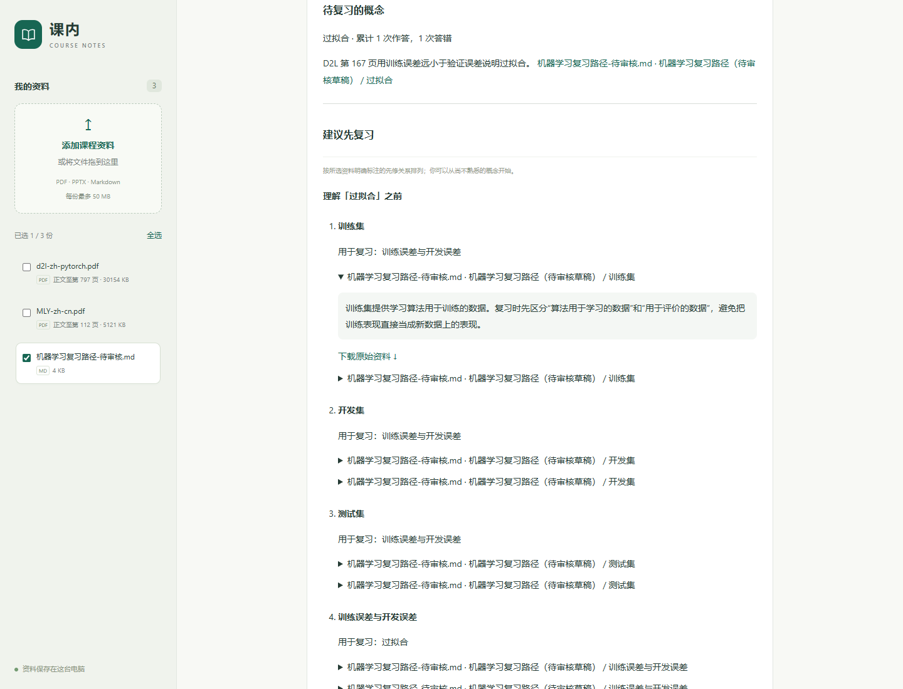

# 真实学习流程验收（2026-10-27）

两本真实教材和待审核课程笔记已在隔离资料库中跑通“对比 → 提问 → 看出处 → 练习 → 答错 → 复习 → 重启 → 正确重答”。本轮发现并修复了两处把先修声明当知识内容的问题。软件流程验证通过，教学适用性仍待人工审核；整本 PDF 的默认出题相关性仍有明确缺口。

## 已修复的问题

1. **定义回答偏题**：问“什么是过拟合？”时，旧逻辑曾选中“学习过拟合前，建议先复习训练误差与开发误差”。引用虽然有效，却没回答定义。现在“什么是／定义”等定义问法会从候选句中排除明确先修声明，离线选句与模型选句使用相同过滤；询问先修关系时仍保留声明。
2. **练习内容不合适**：旧逻辑会把“学习____前，建议先复习……”当作概念填空。练习现在排除这类阅读顺序声明，继续使用来源中的概念讲解句。

没有改写教材或复习笔记。关系图仍读取原声明；图的教学正确性不会因上述软件修复而自动获得认可。

## 验收范围与结果

| 检查 | 结果 |
| --- | --- |
| 实际 Web API 的双教材对照 | 11 组符合预期，出处与参考页检查通过 |
| 定义提问 | 回答包含训练误差、验证误差和过拟合的定义要点，不再用先修声明代替；该项是固定案例要点检查，不是通用语义评分 |
| 引用 | 回答文字对应所引用来源，原文件链接可读取 |
| 聚焦练习 | 单独勾选待审核笔记，生成训练集、开发集、测试集、过拟合、正则化五题 |
| 故意答错一次 | 仅将过拟合题选错，模拟成绩 4 / 5；进入过拟合复习清单 |
| 复习路径 | 训练集、开发集、测试集、训练误差与开发误差，均有笔记讲解出处 |
| 保存与隔离 | 重复提交不改写首次成绩，切换到不含该笔记的资料范围不显示此错题，重启服务后仍恢复原记录 |
| 新练习正确重答 | 模拟成绩 5 / 5，对应错题和复习路径从清单移除 |
| 全套自动化测试 | 310 项通过 |
| 原问答冻结基线 | 9 项检查通过，两次预测一致 |

上述 4 / 5 和 5 / 5 是测试程序利用服务端答案键模拟的行为，不是真实学习者成绩，也不证明复习提高了掌握程度。答案键仅用于验收脚本；公开出题 API 不返回它。

本次“什么是过拟合？”的回答引用待审核笔记。该笔记概括了教材并给出参考页码，不能把它的引用冒充为对教材 PDF 的直接引用。双教材原文对照另外由实际 PDF 验证。

浏览器使用两份真实教材的临时副本，在页面中上传笔记，验证引用弹窗、单独选材、五题作答、原文展开、刷新恢复和正确重答。390px 布局无横向溢出；未修改默认资料库或用户作答记录。



## 尚未通过的部分

整本 PDF 的默认首批练习仍可能取到“代码、论坛、符号”等前言或导读内容。本次通过单独勾选课程笔记完成目标概念练习，不能据此宣称整本教材自动出题质量已经合格。

后续已加入[按概念或章节练习](targeted-practice-v1.md)，并检查真实教材的范围隔离、题目出处和选项来源。本页保留当时整本 PDF 出题的观察记录；题目教学质量仍待人工审核。

独立人工语义审核和课程复习顺序审核仍待完成。[可填写的审核清单](../eval/reviews/learning-acceptance-v1.md)列出了六组原文对照、两组路径检查和两组练习检查，附页码、代理初步观察及待填写的结论。

## 复现

[固定输入及检查范围](../eval/learning-flow-v1.json)、[完整 API 验收报告](../eval/reports/learning-flow-v1.json)、[浏览器记录](../eval/reports/learning-flow-browser-v1.json)、[问答基线报告](../eval/reports/baseline-v12-learning-flow.json)。

```powershell
.\.venv\Scripts\python.exe -X utf8 -m scripts.evaluate_learning_flow
.\.venv\Scripts\python.exe -X utf8 -m scripts.evaluate_baseline --output eval/reports/baseline-v12-learning-flow.json
.\.venv\Scripts\python.exe -m pytest -q --basetemp .tmp/learning-flow-tests
```

验收脚本校验输入指纹，在 `.tmp` 下创建一次性资料库，调用实际问答、比较、练习和复习接口，再用新应用实例验证恢复。报告不将结构检查通过标记为人工审核完成。
