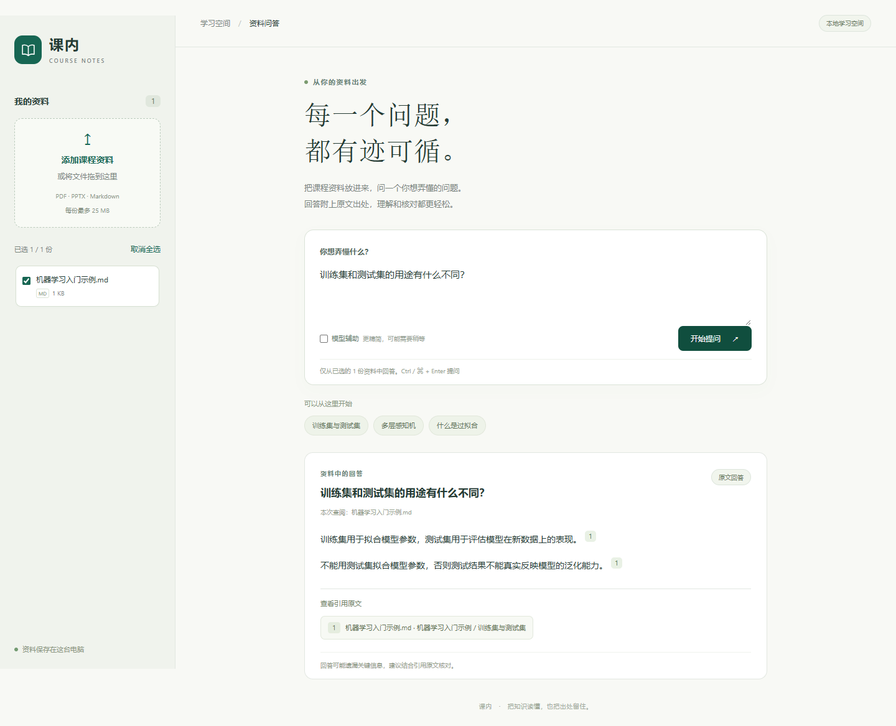

# 网页版使用说明

## 打开网页

在项目文件夹中双击 `start-web.cmd`，保留打开的窗口，然后访问：

**http://127.0.0.1:8000**

首次体验可以点“用一份机器学习示例试试”，再点“开始提问”。不用先配置模型，也不用手动建索引。关闭启动窗口或按 Ctrl+C 会停止服务。

也可以在项目目录用 PowerShell 启动：

```powershell
.\start-web.ps1
```

新环境先运行 `uv sync --extra dev`。其他系统可运行 `python -m course_rag_assistant.web`；安装后的命令入口为 `course-rag-web`。端口被占用时可用 `--port 8001`，PowerShell 启动脚本对应 `-Port 8001`。

## 日常使用

1. 点击“添加课程资料”，或把文件拖入左侧区域。支持文字版 PDF、PPTX、Markdown；每份最多 25 MB。
2. 勾选要查阅的资料，输入问题，点击“开始提问”。也可按 Ctrl+Enter（Mac 为 ⌘+Enter）。
3. 点击回答旁的引用编号，查看教材原文、页码或笔记章节。PDF 可以在新标签页打开对应页面，其他格式可以下载原文件。

PDF 页码按文件中的页面顺序计算，可能与教材印刷页码不同。扫描版 PDF 暂不支持；没有可提取文字或文件损坏时，页面会给出提示。



## 可选：启用本机模型

已经启动 Ollama 且装有 `qwen3.5:9b` 时，用以下方式启动：

```powershell
.\start-web.ps1 -Model qwen3.5:9b
```

进入网页后勾选“模型辅助”。模型辅助默认不勾选；没有模型时，仍可直接返回有出处的原文。模型调用失败会回退到原文，并在页面明确提示。配置状态不等于模型服务在线。

网页也沿用原项目的模型环境变量。如果自行配置远程 API，启用模型辅助会按该配置把候选资料发送给对应服务。

## 数据与实现范围

- 上传文件和提取结果保存在 `data/web/`，已被 Git 忽略。重启后资料仍在；原有 `data/raw/` 资料不会自动混入网页，需要主动上传。
- 每份文件单独保存，并使用独立标识处理同名文件；答案只查阅本次勾选的资料。网页不会覆盖原教材索引。
- 第一版使用独立的 BM25 关键词检索。模型辅助增加聊天模型段落筛选和原文句子选择；不套用旧教材的向量索引，也不代表网页已经复现旧教材的混合检索评测成绩。
- 继续使用既有证据检查、拒答和引用校验。答案仍可能漏选要点，引用只能帮助核对，不能保证回答全面。
- 服务仅监听 `127.0.0.1`，定位为单人本地工具，未部署到外网。当前没有账号、OCR、会话历史、资料删除界面或自动向量化功能。
- 资料库上限 50 份，单文件最多 1500 个 PDF 页面、10000 个片段及 800 万字符；PPTX 解压内容限制为 80 MB。超出时请按章节拆分。

## 验证记录

本轮新增 19 项接口测试，全项目 200 项测试通过。覆盖三种格式上传、真实 PDF 页码、按资料范围提问、同名文件隔离、重启恢复、无证据拒答、模型失败回退、无效文件、文件大小限制、路径与跨站请求检查。

Chrome 自动化跑通：空资料库、示例导入、Markdown 上传、提问、点击引用、关闭原文窗口、切换资料范围、刷新保留、损坏文件提示，以及桌面和 390px 手机布局。真实本机 `qwen3.5:9b` 辅助回答成功。另在正常内容安全策略下验证了 PDF 上传、第二页引用和打开对应 PDF 页面的跳转。

浏览器检查未出现页面脚本错误。常规交互检查因本机旧版 Playwright 的执行方式使用了仅限测试浏览器的 CSP 绕过；应用本身仍保留 CSP，PDF 端到端检查未绕过 CSP。没有为网页新增运行时依赖。
