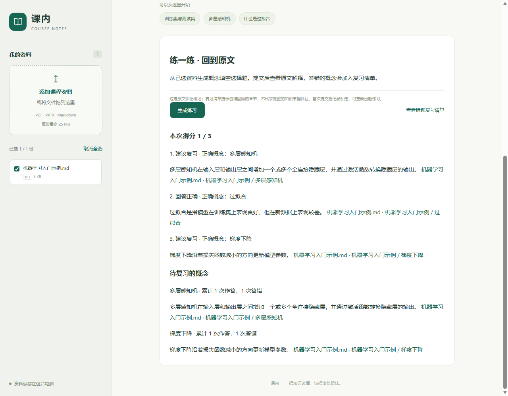
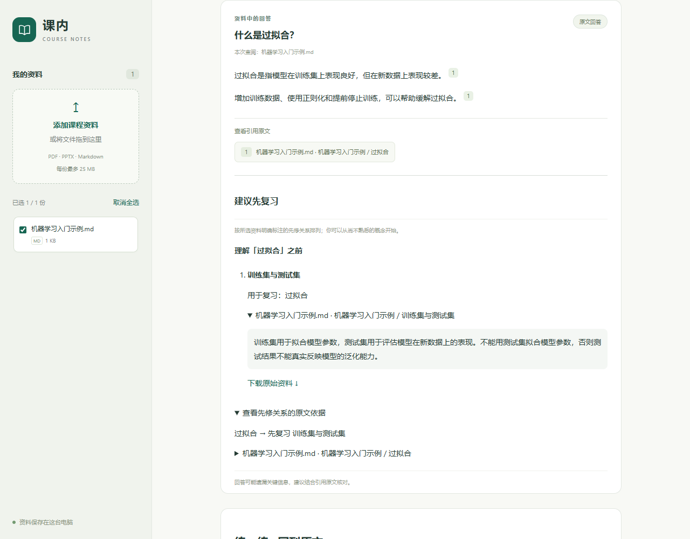
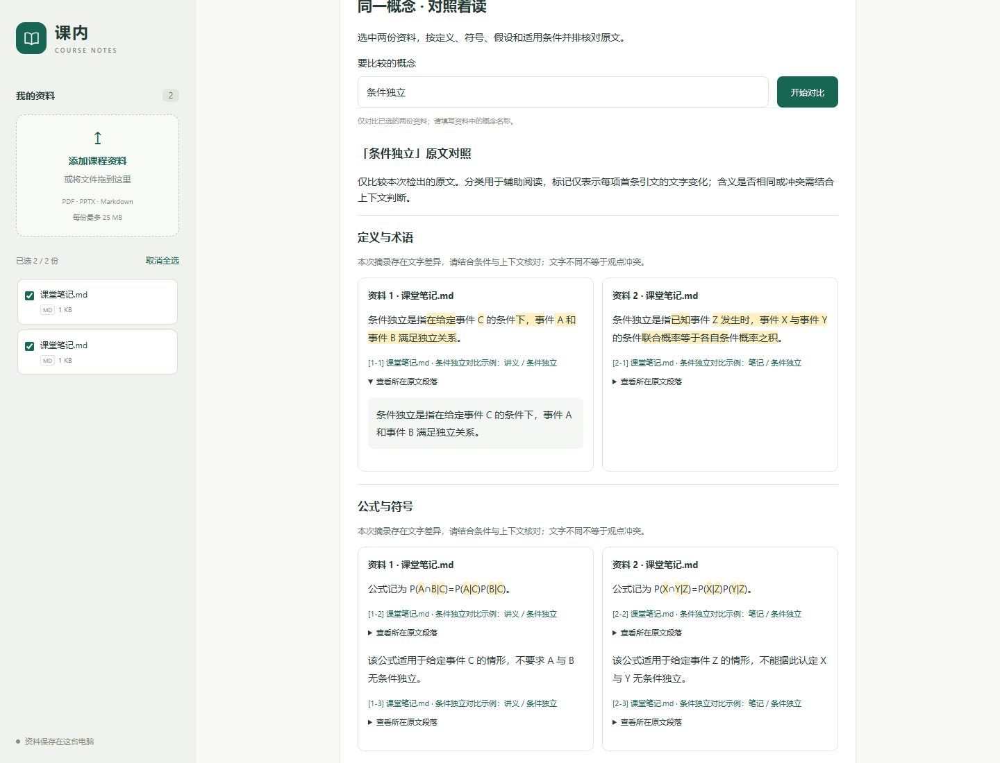

# 网页版使用说明

## 打开网页

在项目文件夹中双击 `start-web.cmd`，保留打开的窗口，然后访问：

**http://127.0.0.1:8000**

首次体验可以点“用一份机器学习示例试试”，再点“开始提问”。不用先配置模型，也不用手动建索引。关闭启动窗口或按 Ctrl+C 会停止服务。

也可以在项目目录用 PowerShell 启动：

```powershell
.\start-web.ps1
```

新环境先运行 `uv sync --extra dev`。其他系统可运行 `python -m course_rag_assistant.web`；安装后的命令入口为 `course-rag-web`。端口被占用时可用 `--port 8001`，PowerShell 启动脚本对应 `-Port 8001`。

## 日常使用

1. 点击“添加课程资料”，或把文件拖入左侧区域。支持文字版 PDF、PPTX、Markdown；每份最多 50 MB。
2. 勾选要查阅的资料，输入问题，点击“开始提问”。也可按 Ctrl+Enter（Mac 为 ⌘+Enter）。
3. 点击回答旁的引用编号，查看教材原文、页码或笔记章节。PDF 可以在新标签页打开对应页面，其他格式可以下载原文件。

PDF 页码按文件中的页面顺序计算，可能与教材印刷页码不同。扫描版 PDF 暂不支持；没有可提取文字或文件损坏时，页面会给出提示。


## 可选：启用本机模型

已经启动 Ollama 且装有 `qwen3.5:9b` 时，用以下方式启动：

```powershell
.\start-web.ps1 -Model qwen3.5:9b
```

进入网页后勾选“模型辅助”。模型辅助默认不勾选；没有模型时，仍可直接返回有出处的原文。模型调用失败会回退到原文，并在页面明确提示。配置状态不等于模型服务在线。

网页也沿用原项目的模型环境变量。如果自行配置远程 API，启用模型辅助会按该配置把候选资料发送给对应服务。

## 数据与实现范围

- 上传文件和提取结果保存在 `data/web/`，已被 Git 忽略。重启后资料仍在；原有 `data/raw/` 资料不会自动混入网页，需要主动上传。
- 每份文件单独保存，并使用独立标识处理同名文件；答案只查阅本次勾选的资料。网页不会覆盖原教材索引。
- 第一版使用独立的 BM25 关键词检索。模型辅助增加聊天模型段落筛选和原文句子选择；不套用旧教材的向量索引，也不代表网页已经复现旧教材的混合检索评测成绩。
- 继续使用既有证据检查、拒答和引用校验。答案仍可能漏选要点，引用只能帮助核对，不能保证回答全面。
- 服务仅监听 `127.0.0.1`，定位为单人本地工具，未部署到外网。当前没有账号、OCR、会话历史、资料删除界面或自动向量化功能。
- 资料库上限 50 份，单文件最多 1500 个 PDF 页面、10000 个片段及 800 万字符；PPTX 解压内容限制为 80 MB。超出时请按章节拆分。

## 验证记录

网页版初版新增 19 项接口测试，当时全项目 200 项测试通过。覆盖三种格式上传、真实 PDF 页码、按资料范围提问、同名文件隔离、重启恢复、无证据拒答、模型失败回退、无效文件、文件大小限制、路径与跨站请求检查。v12 加入练习与固定基线后，全套 219 项测试通过。

Chrome 自动化跑通：空资料库、示例导入、Markdown 上传、提问、点击引用、关闭原文窗口、切换资料范围、刷新保留、损坏文件提示，以及桌面和 390px 手机布局。真实本机 `qwen3.5:9b` 辅助回答成功。另在正常内容安全策略下验证了 PDF 上传、第二页引用和打开对应 PDF 页面的跳转。

浏览器检查未出现页面脚本错误。常规交互检查因本机旧版 Playwright 的执行方式使用了仅限测试浏览器的 CSP 绕过；应用本身仍保留 CSP，PDF 端到端检查未绕过 CSP。没有为网页新增运行时依赖。

## 原文练习与错题回顾

添加并勾选资料后，点击页面下方的“生成练习”。系统从完整的原文句子中遮去概念名称，生成选择题；提交全部题目后显示得分、原文和资料链接。示例资料可生成三道题。缺少可用的概念句或干扰选项时会说明原因，不会编造题目。

点击“查看错题复习清单”可回顾当前所选资料中的待复习概念、累计答错次数和出处。练习与提交结果保存在资料目录下的 `quiz.sqlite3`，重启后保留。同一份练习只记录首次提交，重试请求不会增加错题次数；可重新生成练习，答对后该概念从待复习清单移除。实际出题数量可能少于请求数量。

这是原文识记练习与章节回看，尚不支持开放式答案的语义判分，也不将一次答错等同于已确认的知识盲区。PDF 按原文件页码打开，Markdown/PPTX 可下载原文件核对。



## 先修概念与复习顺序

回答、判分结果和错题复习清单现在支持“建议先复习”。第一版读取资料里明确写出的先修关系，按基础概念在前的顺序展示多级依赖；展开条目可以核对概念原文、关系依据和文件出处。关系仅来自当前选择的资料，不将答错直接判定为前置知识缺失。

Markdown 推荐在概念标题下单独写一行，多个先修概念使用顿号分隔：

```markdown
## 朴素贝叶斯
先修概念：条件独立、贝叶斯定理。

这里写该概念的课程讲解。

## 条件独立
先修概念：条件概率。

这里写条件独立的课程讲解。

## 条件概率
这里写条件概率的课程讲解。
```

也支持完整句式 `学习朴素贝叶斯前，建议先复习条件独立、贝叶斯定理。`，或把“建议先复习”换成“需要先理解”。完整句式可出现在 PDF/PPTX 提取的正文中；前置概念的讲解通过同名章节标题或概念标签定位。暂不做同义词归一、任意自然语言关系推断或自动知识掌握诊断。

- 每条关系保留原文依据；仅共同出现的概念不会自动建立先修关系。
- 同名概念在所选资料中可跨文件查找讲解，每个概念最多展示三处原文。不同含义的同名概念请通过标题限定语区分。
- 未找到独立讲解章节时会提示补充笔记；只有“先修概念”声明的段落不算讲解。
- 环状关系或超过 32 个概念的依赖路径会提示无法排列完整顺序，保留关系依据供核对。
- 回答拒答时不附带先修路径；判分只为错题展示建议，再练答对后随错题一起移出复习清单。

体验方式：点击“用一份机器学习示例试试”，提问“什么是过拟合？”，回答下方会建议先复习“训练集与测试集”。已有旧示例的资料库可再次添加示例并只勾选新版本。

验证记录（2026-10-26）：先修图、问答、Quiz 与网页接口共 32 项测试通过，覆盖多级顺序、循环、缺失讲解、资料范围、同名文件、错题重启保留和答对后移除。Chrome 在正常内容安全策略下跑通问答路径、原文展开、错题复习、刷新恢复与再次答对；390px 手机布局无横向溢出，无浏览器脚本异常。



## 跨教材原文对比

在资料库恰好选中两份资料，在“同一概念 · 对照着读”中输入概念名称（例如“条件独立”），点击“开始对比”。桌面端并排展示，手机端按资料顺序上下排列。切换所选资料时会隐藏旧对比结果，避免误认本次范围。

系统分别检索两份资料，按定义与术语、公式与符号、假设、适用条件归类原文，未归类的摘录放在“其他相关原文”。每项每份资料最多三条摘录；每条均可展开所在原文段落，并打开 PDF 对应页或下载笔记/PPTX 原文件。同名文件通过“资料 1 / 资料 2”及各自的文件 ID 区分。

浅色标记是每项两份资料首条引文的文字差异。结果区分“摘录文字一致”“摘录文字不同”“单边未检出”“两边未检出”；文字不同不会被判断为观点冲突，文字一致也不表示两份教材的全部论述一致。分类基于原文关键词，属于阅读提示，不是语义判定；公式不会被自动化简或验证等价。

对比无需模型，通常按概念标题、概念标签、概念主语或“称为/叫做”等明确命名句筛选正文。请填写概念名称，而非完整问题。现在支持“开发集／验证集”的模型选择用途对照，以及“方差”的两类含义选择；其他概念仍按原名称检索，暂不支持通用跨语言、同义词推断或隐含概念识别。未检出不代表原书一定没有相关内容。每个检索术语最多检查 12 个匹配段落，长段落只摘录可保留完整原文的句子；超过 8000 字符的上下文请通过原文件查看。

可直接上传以下两份自写示例，输入“条件独立”体验不同记号和措辞的对照：

- [条件独立：讲义](../data/comparison-samples/条件独立-讲义.md)
- [条件独立：笔记](../data/comparison-samples/条件独立-笔记.md)

接口：`POST /api/compare`，请求包含 `concept` 和两个不同的 `document_ids`，方差查询可附带 `sense`。沿用网页的工作区令牌和来源检查，返回每份资料的检出状态、术语对齐决定、按维度排列的引用、文字差异片段及原文上下文。含义未选时返回 `needs_disambiguation`；两边都有候选但用途对应无法确认时返回 `needs_review`，不生成差异高亮。完整参数见[术语对齐记录](course-alignment-v1.md#api)。

验证记录（2026-10-26）：对比、先修关联、问答与练习相关的 48 项测试通过；覆盖相似概念误匹配、同名文件隔离、公式优先、否定词与数字差异、单边缺失、PDF 第二页出处以及接口范围检查。Chrome 在正常内容安全策略下验证了原文展开、文字标记、切换资料后清除旧结果和 390px 手机布局，无脚本异常或横向溢出。



后续真实教材检查修复了 PDF 换行导致的摘录丢失、英文词内弯撇号导致的误断句，以及中文概念标题附英文括注的识别。最终 56 项相关测试通过；真实课程验收结果和剩余缺口见[课程差异化验收记录](course-features-v1.md)。

双教材补充验证：已导入 `d2l-zh-pytorch.pdf` 与 `MLY-zh-cn.pdf`，可输入“训练集”“测试集”“过拟合”体验真实资料对照。新增 PDF 重叠加粗去重、明确命名句与相邻解释保留；全套 272 项测试通过。六组真实检查与已知缺口见[双教材验证记录](course-pairs-v1.md)。旧服务若未显示新资料，重启本地服务后刷新。

后续补充：带项目符号的“加入正则化（……）：……”技术条目也可检出。当前七组双教材检查、全套 282 项测试通过；另有标明待审核的课程复习笔记，已在临时资料库验证五步学习路径。使用范围与待审核事项见[术语召回与复习路径草稿](course-pairs-v2.md)。

最新补充：输入“开发集”或“验证集”可查看两边模型选择/调参用途的对应原句，页面保留各自的原文术语。输入“方差”先选择含义，再查看当前语境的摘录；修改输入或所选资料会清除旧结果。11 组真实检查与全套 302 项测试通过，详细边界和截图见[术语对齐与方差含义选择](course-alignment-v1.md)。更新后重启本地服务并刷新即可体验。
