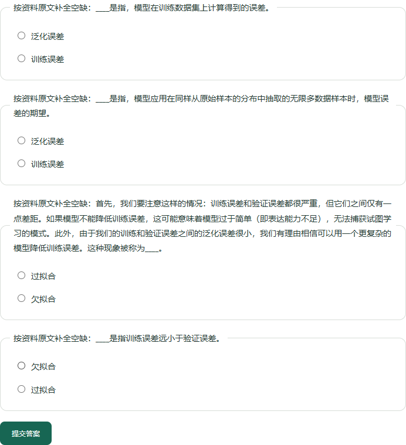

# 练习上下文与新章节检查

后续：[第 6.1 节编号释义修复](numbered-definitions.md)。下文保留修复前的 0 题记录。

日期：2026-10-28。审查人：Codex 助手。

第 4.4 节的欠拟合题改为保留正文语境，模糊的关系题不再用于凑足五题。对两个预先选定的新章节的首次检查仍发现缺陷；修复后保留首次结果，并明确将后续检查视为开发回归。当前没有建立跨章节的教学质量验收。

## 第 4.4 节的变化

| 项目 | 原行为 | 当前行为 |
| --- | --- | --- |
| 欠拟合 | 第 167 页的小结简写，仅说无法继续减少训练误差 | 第 161 页连续四句，保留训练与验证误差都高、差距小、模型可能过于简单与表达能力不足等条件 |
| 数据集大小 | “模型复杂性和____之间通常存在关系” | 排除这类只声明关联而没有具体关系的句子；章节出题数量为 4 / 5 |
| 干扰项 | 混用误差、拟合状态、数据集大小 | 有合适候选时优先共同中文词尾，形成训练误差/泛化误差、欠拟合/过拟合两组 |
| 英文提示 | 先前只遮去直接定义中的别名 | 补充用途说明和带上下文命名句的别名处理，原文解释保留别名 |

四题依次为训练误差（158 页）、泛化误差（158 页）、欠拟合（161 页）、过拟合（167 页）。四题均为两选项。减少跨类别提示不代表提高了统计区分度，两选项仍有较高的猜中概率。



## 上下文与出处约束

对“这种现象被称为……”等命名句，最多携带同一片段中的前三句。合并文本必须在原文中连续存在，不能跨文件、页、片段或跳过标题；每个句子继续独立经过引用验证。超过 400 字、前文缺失或缺少干扰选项时放弃该候选。

过滤条件保留有具体方向的关系、否定、适用条件及公式括号。命名句中的 underfitting、用途说明中的 loss function 在题干中隐藏，原文不修改。过滤规则仍不能识别全部歧义或英文条件。

欠拟合所在片段的旧提取标题是“K折交叉验证”，而 PDF 原页实际位于 4.4.3；本轮保留原始片段元数据，引用准确指向第 161 页。这也说明片段标题与章节识别仍需要改进。旧练习和已保存答题记录保持创建时的内容。

## 两个新章节：首次检查与修复后检查

在查看生成题目前先记录[检查范围](../eval/quiz-transfer-v1.json)与教材指纹。第 3.1 节按当前识别范围为 PDF 103–105 页，第 6.1 节为 236–240 页；这只代表当前提取范围，不保证覆盖教材完整章节。逐页核对了实际用到的 104、105、238、239 页。

| 章节 / 题目 | 首次观察 | 修复后与助手判断 |
| --- | --- | --- |
| 线性回归：偏置 | 保留全部特征为 0 的条件 | 保留，可作基础识记；选项仍混合参数、模型与函数，较容易排除 |
| 线性回归：损失函数 | loss function 直接提示答案 | 已隐藏英文，原句仍保留；选项类别差异仍限制教学价值 |
| 线性回归：线性模型 | 仿射变换由权重和偏置确定 | 原文完整，保留；与损失函数相比仍较易判断 |
| 卷积：平移不变性 | “现在引用上述的第一个原则”没有解释原则内容 | 排除 |
| 卷积：局部性 | “现在引用上述的第二个原则”依赖未展示的前文 | 排除 |
| 卷积：通道 | “然而这种方法有一个问题”缺少方法所指；三种原色与选项类型也容易提示答案 | 排除 |

[首次观察报告](../eval/reports/quiz-transfer-v1.json)保留原始六题及当时规则的指纹。它的 `passed` 只指来源与范围等软件检查，助手内容审查未通过：发现一处英文提示、两道纯指代题及一处上下文缺失。

根据首次观察修正规则之后，[开发回归报告](../eval/reports/quiz-transfer-v2.json)记录线性回归 3 / 5 题，卷积章节 0 题并返回明确的内容不足提示。报告单独标注 `all_chapters_produce_practice: false`、`teaching_acceptance: not_established`。零题说明当前抽取能力不足，不能算作该章节具备练习能力。后续结果不再视作未见样例的独立验证。

## 验证

- 全套 365 项测试通过。新增覆盖模糊关系排除、具体条件与否定保留、命名上下文、跨页/跨片段/标题边界、英文提示及指代性导读句。
- [真实范围练习](../eval/reports/targeted-practice-v4.json) 25 项检查通过，覆盖连续原文、四题不凑数、条件保留、成组选项及错题恢复。新版[检查样例](../eval/quiz-quality-v2.json)独立保存，旧版样例和报告保留。
- [原有学习流程](../eval/reports/learning-flow-v4-quiz-context.json) 20 项检查通过。
- [浏览器记录](../eval/reports/learning-session-browser-v2.json)覆盖长题干、4 / 5 提示、4/4 模拟提交、错题刷新恢复和答对清除，并验证新章节 3 题、0 题提示以及旧题清除。390px 布局没有横向溢出，无页面脚本异常。
- 修改过的 Python 文件通过 Ruff 检查。模拟答题仅在隔离资料库执行。

## 复验与后续重点

```powershell
.\.venv\Scripts\python.exe -X utf8 -m pytest -q --basetemp .tmp/quiz-context-tests
.\.venv\Scripts\python.exe -X utf8 -m scripts.evaluate_targeted_practice
.\.venv\Scripts\python.exe -X utf8 -m scripts.evaluate_quiz_transfer
.\.venv\Scripts\python.exe -X utf8 -m scripts.evaluate_learning_flow --output eval/reports/learning-flow-v4-quiz-context.json
node scripts/review_learning_session.cjs
```

浏览器依赖配置沿用[上一轮记录](../eval/reviews/learning-session-v1.md)。重启日常网页服务并重新生成练习即可使用新规则。

本轮已处理两道已知弱题和新章节暴露的可复现缺陷。剩余重点是章节/片段边界、卷积等内容的完整概念抽取，以及无需靠类别即可区分的干扰项。固定字面规则还不足以满足通用题目质量要求；进一步开发应保留这轮失败证据，并使用新的未见样例检验。
