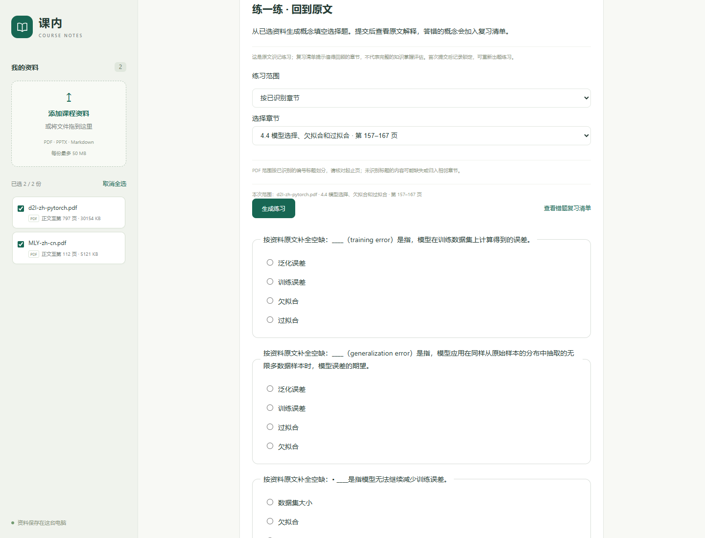

# 练习题干与选项改进

2026-10-28 后续：[助手走查](../eval/reviews/learning-session-v1.md)已修复定义题的英文别名泄题，原文解释继续保留别名。最新为 347 项测试、24 项范围练习检查通过；下文保留初版记录与旧截图。欠拟合小结简写、数据集大小关系题和干扰项区分度仍列为改进项。

在按概念、章节限定范围之后，本轮继续处理范围内的低价值题目。新生成的练习会排除可识别的导读句、提问句和读者操作指令，优先使用直接定义、用途说明，再考虑其他来源句。既有练习保留创建时的题目和判分记录。

## 真实章节的变化

使用原有两本 PDF，在隔离资料库检查 D2L 第 4.4 节（PDF 第 157–167 页）。

| 原有问题 | 现在的行为 |
| --- | --- |
| “为了进一步讨论这一现象，我们需要了解____。” | 排除该导读句，改用训练误差和泛化误差的定义 |
| “____由什么构成是一个复杂的问题。” | 排除只提出问题的句子 |
| 只识别“训练误差”后的直接中文定义标记，漏掉英文括注 | 支持“训练误差（training error）是指……”形式，完整原句和括注保留在出处中 |
| “初始化模型参数”“使用权重衰减”等操作标题进入干扰项 | 操作式标题不直接作为概念；有明确概念定义时可以保留 |
| 过拟合选项偏向相邻章节的操作名 | 优先同一已识别编号节，再参考页距和定义质量 |

当前五题为训练误差（第 158 页）、泛化误差（第 158 页）、欠拟合（第 167 页）、过拟合（第 167 页）、数据集大小（第 162 页）。前四题使用定义；第五题保留“对于固定的任务和数据分布”的原文条件。

按目标“过拟合”生成的题目仍来自第 167 页。四个选项为过拟合、欠拟合、泛化误差、数据集大小；不再混入操作标题。选项在题干中已出现时会被排除。章节模式继续严格限制题干与选项的来源，不因候选不足扩大范围。



## 验证结果

- 全套 **334 项测试通过**，包括新增的导读句排除、双语括注定义、否定与条件保留、同节选项优先、相似概念隔离和候选不足检查。
- [真实教材检查](../eval/reports/targeted-practice-v2.json) **22 项通过**，覆盖五题内容、原文出处、选项来源、范围隔离和错题重启恢复。
- [原有学习流程](../eval/reports/learning-flow-v2-quiz-quality.json) **20 项通过**，仍可从笔记练习进入先修复习，模拟正确重答后移除错题。
- [Chrome 检查](../eval/reports/targeted-practice-browser-v2.json)通过，验证定义题显示、范围切换、错题清单和 390px 手机布局；无脚本异常或横向溢出。

新增的[固定检查样例](../eval/quiz-quality-v1.json)记录已观察到的弱题、预期概念、页码和选项。报告校验教材指纹并记录样例指纹，旧版报告保留用于比较。所有验收使用临时资料库，不向日常资料库写入模拟答题记录。

```powershell
.\.venv\Scripts\python.exe -m pytest -q --basetemp .tmp/quiz-quality-check
.\.venv\Scripts\python.exe -X utf8 -m scripts.evaluate_targeted_practice
.\.venv\Scripts\python.exe -X utf8 -m scripts.evaluate_learning_flow --output eval/reports/learning-flow-v2-quiz-quality.json
```

## 使用与边界

重启本地服务，刷新网页后重新生成练习即可。资料、章节选择和错题复习的使用方式见[范围练习说明](targeted-practice-v1.md)。

这些规则修复的是已观察到的选句问题，不能识别所有低价值或歧义题目。同节出现的词语不一定是难度合适的干扰项；中英文括注、目标概念名称仍可能提示答案。因此当前练习适合回顾原文，不用于评估知识掌握程度或考试成绩。题目教学价值与课程复习顺序仍保留[人工审核状态](../eval/reviews/learning-acceptance-v1.md)。
