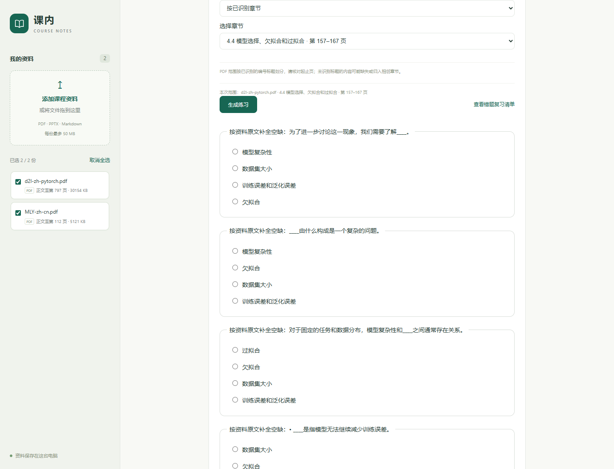

# 按概念或章节练习

“练一练 · 回到原文”现在默认按目标概念出题。先勾选资料，再输入“过拟合”等概念名称，或切换到“按已识别章节”选择章节。更新后重启本地服务并刷新网页。

- 按概念：优先采用目标概念的直接定义，只生成该概念的题目；干扰选项取自已选资料中的其他概念，优先同文件相近页。同一概念不重复出题，通常为 1 题。
- 按章节：下拉框按来源文件分组，显示标题与起止页。题干和选项均来自选定章节，包含其子章节，止于下一个同级或上级标题。Markdown 支持只有子章节、没有独立正文的父章节。
- 题量不足时显示实际数量，不扩大范围。找不到目标、章节不属于所选资料、没有可用的完整句子或干扰选项时明确提示，不能自动退回整本教材。
- 切换资料、概念或章节会清除当前题目和结果；错题复习沿用当前范围。已保存练习保留创建时的范围，重启后仍可核对。
- “全部已选资料”保留旧模式，仍可能出现前言或导读内容。

## 真实教材验证

输入文件为已固定 SHA-256 的 `d2l-zh-pytorch.pdf` 和 `MLY-zh-cn.pdf`。验证在临时资料库进行，不往日常资料库写入测试错题。

| 场景 | 结果 |
| --- | --- |
| 目标“过拟合” | 1 题，采用 D2L 第 167 页的直接定义 |
| D2L 第 4.4 节 | 5 题，题干均在第 157–167 页的章节原文中，选项也在章节范围内 |
| 不存在的概念／其他文件的章节 | 返回 422，不生成范围外题目 |
| 答错、切换范围、重启、正确重答 | 错题按范围显示并恢复，再练答对后移出清单 |
| Chrome 和 390px 手机宽度 | 范围切换、题目清除和资料切换通过，无脚本错误或横向溢出 |

验证结果：全套 321 项测试通过，真实教材 18 项检查通过。记录：[接口与原文检查](../eval/reports/targeted-practice-v1.json)、[浏览器检查](../eval/reports/targeted-practice-browser-v1.json)。



## 接口及复验

`POST /api/quiz/sections` 接收 `document_ids`，返回章节 ID、所属文件、标题、起止页及段落数。

`POST /api/quiz` 和 `POST /api/review` 增加可选字段 `target_concept`（2–40 字符）及 `section_id`。两个字段一起提供时取交集；均不提供时保留全部资料模式。判分读取练习保存的范围，不能通过当前网页输入改变旧练习。所有接口沿用工作区令牌和资料选择校验。

```powershell
.\.venv\Scripts\python.exe -m pytest -q --basetemp .tmp/targeted-practice-check
.\.venv\Scripts\python.exe -X utf8 -m scripts.evaluate_targeted_practice
```

## 当前边界

这是原文识记练习，目标概念名称可能提示填空答案，不用于判断知识掌握程度。章节范围减少了整本教材前言的干扰，但个别章节过渡句仍可能入选；题目教学价值和干扰项质量需要人工审核。

PDF 章节边界依赖已识别的编号标题，页面显示的是 PDF 文件页序。未识别标题的内容可能缺失或并入相邻章节，应核对起止页；不声称所有教材的章节识别都准确。概念按原名称匹配，暂不将对比功能的同义术语或“方差”义项选择自动用于出题。先修复习建议继续查找所选资料中的明确声明，可以跨出当前章节，以便补齐前置知识。
