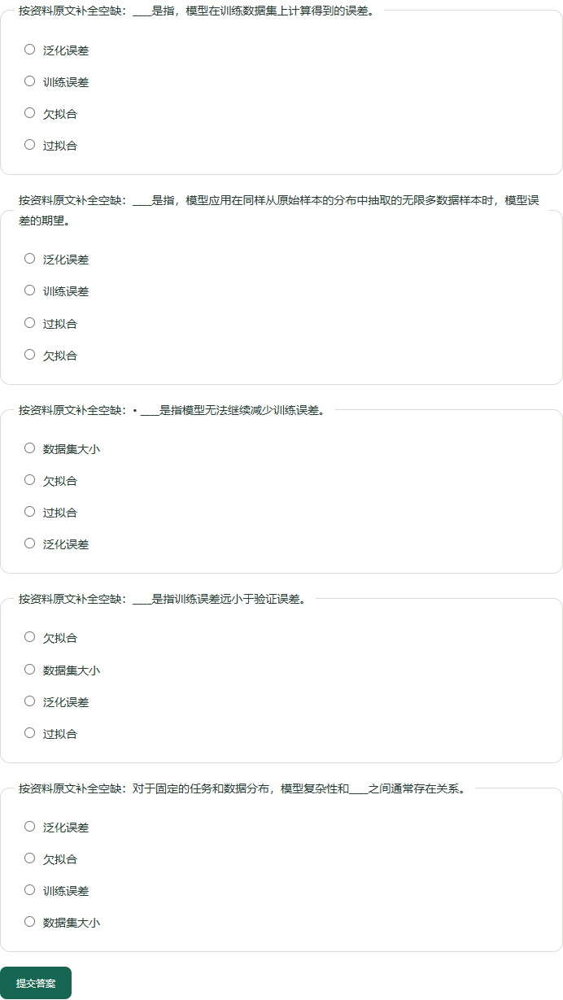

# D2L 第 4.4 节：助手学习流程审查

准备日期：2026-10-27。完成记录：2026-10-28。审查人：Codex 助手。状态：**助手走查与修复完成；教学质量仍有改进项**。用户委托助手完成本轮体验，本文不代表真人学习或教师审核。

## 范围与方法

只选 D2L，关闭模型辅助。在日常资料库的隔离副本中，用 Chrome 操作问答、引用、章节练习、提交、错题、刷新和再练，没有向日常资料库写入模拟作答。PDF 第 158、162、167 页经 Poppler 渲染并逐页核对，另读第 159 页上下文。助手已经看过固定样例与答案，5/5 只验证判分与流程，不是盲测成绩。

## 两项问答

| 问题 | 修复前实际结果 | 修复后实际结果 | 结论 |
| --- | --- | --- | --- |
| 什么是过拟合？ | 第 166 页高阶多项式例子，未直接定义概念 | 第 158 页“将模型在训练数据上拟合的比在潜在分布中更接近的现象称为过拟合……”完整原句 | 能直接回答；原句也定义了正则化，略有冗余，保留完整证据 |
| 训练误差和泛化误差有什么区别？ | “多。”和“2的可能性将会降低……”PDF 残片 | 第 158 页两项定义，按提问顺序显示，保留原始分布、无限样本与期望条件 | 可作为定义对照；如何估计泛化误差需继续读原页 |

离线回答现在从通过证据筛选的检索结果中优先选择明确、完整的定义。支持有限的中文定义问句和双概念区别问句，双概念必须同时找到定义才使用新规则。保留引用验证、原检索范围及正常模型选句行为；模型失败后的离线回退可使用新规则。它不是通用语义理解。

PDF 筛选新增单汉字残句及可识别的分数分母续行排除，保留独立完整的数字说明，不猜测或拼接公式。

## 五道题逐项审查

章节为 4.4 模型选择、欠拟合和过拟合（PDF 第 157–167 页）。实际五题，助手按已知答案提交 5/5。

| 题号 / 概念 | 页码 | 原文与选项审查 | 助手结论 |
| --- | --- | --- | --- |
| 1 训练误差 | 158 | 原定义完整；原题可凭 training error 翻译作答，现题干隐藏别名、提交后原文仍保留。泛化误差是有效对照，欠拟合/过拟合较易排除 | 可作基础识记 |
| 2 泛化误差 | 158 | 保留同分布、无限样本与期望条件；已隐藏 generalization error 提示。训练误差是有效对照，其余选项区分度有限 | 可作基础识记，不能证明会估计泛化误差 |
| 3 欠拟合 | 167 | 与教材小结一致，但“无法继续减少训练误差”单独出现，容易被理解为所有训练停滞都属于欠拟合；两个干扰项易排除 | 理解题需要补充正文语境，目前仅供原文回顾 |
| 4 过拟合 | 167 | 保留训练误差与验证误差比较；欠拟合有对照价值，数据集大小/泛化误差易排除。目标概念模式的范围名也提示答案 | 章节模式可作基础识记，目标模式适合回顾 |
| 5 数据集大小 | 162 | 保留“对于固定的任务和数据分布”；“模型复杂性和____之间通常存在关系”较泛泛，其他误差选项在一般语义下也可能成立，只能靠原文区分 | 区分度低，后续优先换成关系方向或应用题 |

英文别名处理只作用于识别到的定义题干，保留原文、页码、旧练习，以及否定、中文条件、公式/数字括号和可识别的英文条件。通用泄题检测仍不完整。



## 错题与复习

五题正确提交后清单为空。另做明确标记的模拟错误场景：过拟合题选择欠拟合，得到 0/1；清单出现过拟合，原文链接指向第 167 页且可读取。刷新后该记录保留；重新出题选过拟合得到 1/1，待复习清单清空。

助手阅读概括：本节的过拟合表现为对训练数据拟合得过好，对潜在分布或未见数据的表现较差；小结用训练误差远小于验证误差概括。这是助手概括，不是应用生成并验证的新输出。

只选教材时未出现先修路径，符合仅读取明确关系声明的边界。清单可以定位原文，但目前没有针对错误选项的解释；重复题答对也可能来自记忆。

## 验证与结论

- 347 项测试通过，覆盖别名提示、条件保留、双概念定义、模型失败回退和分数残片。
- [范围练习](../reports/targeted-practice-v3.json) 24 项、[原有学习流程](../reports/learning-flow-v3-session-review.json) 20 项检查通过。
- [冻结基线](../reports/baseline-v12-learning-session.json)通过输入指纹、两次重复稳定性与既定质量门槛，未修改基线标注或阈值。
- [Chrome 记录](../reports/learning-session-browser-v1.json)包含实际问答、五题、判分与错题恢复。390px 无横向溢出，无脚本异常；引用弹窗与文件链接可用。

助手结论：可用于原文查阅和基础识记，三类可复现问题已修复。Q03 的通用教学质量仍需改进，优先处理第 3、5 题及干扰项，再用未参与规则调整的新章节问题检验效果。真人学习效果未验证。

## 复验

从项目根目录运行：

```powershell
.\.venv\Scripts\python.exe -m pytest -q --basetemp .tmp/session-review-tests
.\.venv\Scripts\python.exe -X utf8 -m scripts.evaluate_targeted_practice --output eval/reports/targeted-practice-v3.json
.\.venv\Scripts\python.exe -X utf8 -m scripts.evaluate_learning_flow --output eval/reports/learning-flow-v3-session-review.json
.\.venv\Scripts\python.exe -X utf8 -m scripts.evaluate_baseline --output eval/reports/baseline-v12-learning-session.json
node scripts/review_learning_session.cjs
```

浏览器脚本需要 Node、Playwright、Chrome 和 data/web 中的两本教材。未在项目安装 Playwright 时，可将 COURSE_RAG_PLAYWRIGHT 设为已有包的绝对路径；Chrome 可通过 COURSE_RAG_CHROME 指定。脚本不安装依赖，创建隔离副本，完成后关闭自建服务。
